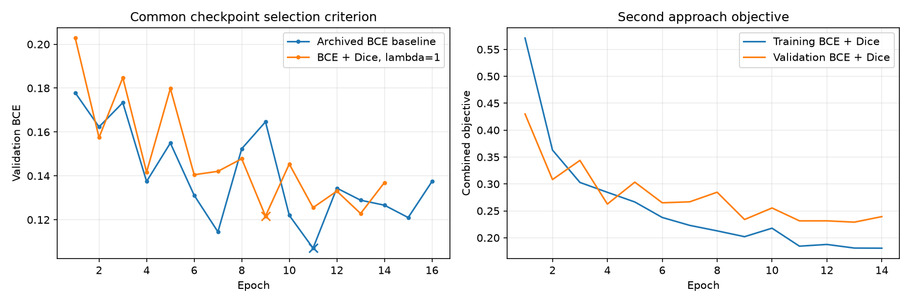
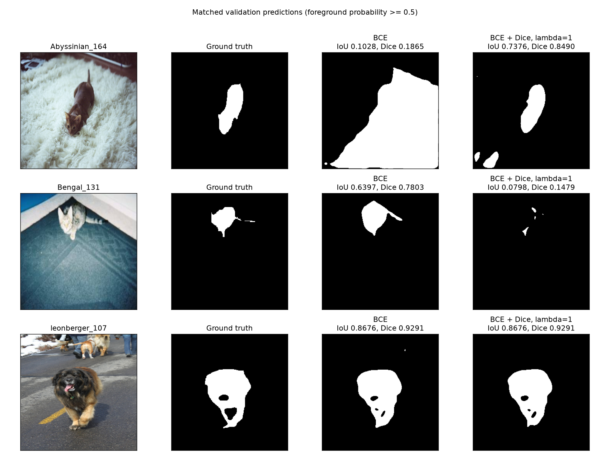
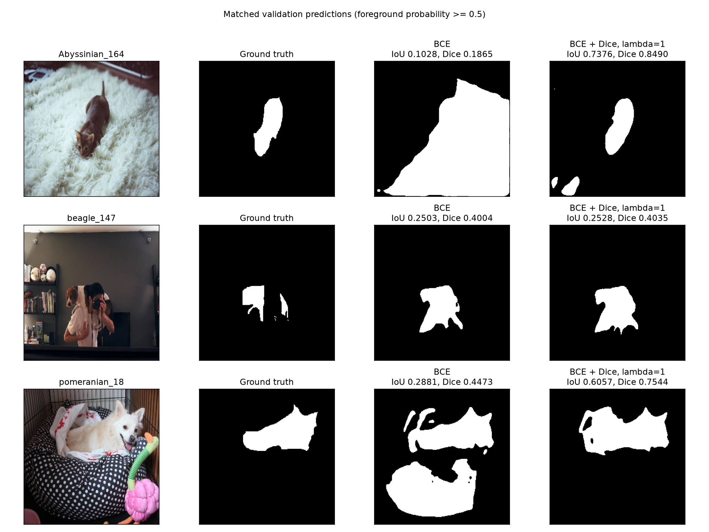

# Second approach — BCE + Dice (20 October 2026)

## New approach

The second approach keeps the custom torchvision U-Net with an ImageNet-pretrained
ResNet-34 encoder (24,521,697 parameters) and changes the optimized loss from
`BCEWithLogitsLoss` to `BCEWithLogitsLoss + 1.0 * SoftDiceLoss`. Lambda=1 was fixed
before training. Soft Dice is computed per image from sigmoid probabilities,
with smoothing 1e-6 in numerator and denominator, and its loss is averaged over
images. No thresholding is used in the differentiable loss.

## Motivation

The experiment tests whether adding an overlap-based term to pixel-level BCE
supervision improves foreground segmentation. The expected benefit is fewer
missed pet regions and excess foreground areas. Global overlap metrics and
selected masks evaluate this hypothesis; a boundary-specific improvement is
not established without a dedicated boundary metric.

## Implementation

Data, model, preprocessing, initialization seed and main training settings
match the archived baseline: 2944/736/3669 train/validation/test images;
256 x 256 resize; ImageNet normalization; train-only horizontal flips (p=0.5);
`trimap == 1` foreground; AdamW with lr=0.0003, weight decay=0.0001, batch size=8,
seed=42, workers=0, maximum 20 epochs, patience=5, no frozen-encoder epochs.
The model starts from ImageNet encoder weights and a freshly initialized
decoder. The BCE results use the saved baseline checkpoint.

The `--selection-metric val_bce` option separates the optimized objective
from checkpoint selection. Both approaches select the minimum validation BCE;
early stopping uses the same criterion. The default `val_loss` policy remains
available. Per-epoch logs include the objective, validation BCE, soft Dice loss,
hard IoU/Dice and elapsed time.

## Initial validation results

| Condition | Mean foreground IoU | Mean foreground Dice | Pixel accuracy | Selected epoch |
| --- | ---: | ---: | ---: | ---: |
| Archived BCE baseline | 0.852994681 | 0.915092323 | 0.957708048 | 11 |
| BCE + Dice, lambda=1 | 0.845619000 | 0.910954427 | 0.953619957 | 9 |
| Difference (second - BCE) | -0.007375681 | -0.004137896 | -0.004088091 | — |

With both checkpoints selected by minimum validation BCE, BCE + Dice scored
0.7376 percentage points lower in IoU and 0.4138 points lower in Dice.
Per-image Dice improved on 324 images,
worsened on 409, and was unchanged on
3 (absolute delta <= 1e-12).

Training ended at epoch 14; the selected validation BCE
is 0.121647083241, and its combined validation objective is
0.233917904775. Total elapsed time was
980.952 seconds (16.349 minutes),
including setup, training, validation and checkpoint writes. Baseline training
time and original hardware were not recorded, so training speed cannot be
compared.

Both models were evaluated on the same 736 validation images using float32,
`model.eval()`, `torch.inference_mode()`, threshold 0.5 and TF32 disabled for
CUDA matmul/cuDNN. IoU and Dice are arithmetic means of per-image scores;
accuracy is total correct pixels / total pixels. Both masks empty yields
IoU=Dice=1; only one empty yields 0. No hard-metric smoothing is applied.

The selected examples show the largest Dice increase, largest decrease, and
smallest absolute change among remaining nonempty-target cases. They are
illustrations chosen by this rule, not a random or representative sample.

| Previous baseline failure | BCE IoU / Dice | BCE+Dice IoU / Dice | FP pixels (BCE -> second) | FN pixels (BCE -> second) |
| --- | ---: | ---: | ---: | ---: |
| Abyssinian_164 | 0.102823 / 0.186472 | 0.737604 / 0.848990 | 30012 -> 1095 | 21 -> 101 |
| beagle_147 | 0.250328 / 0.400420 | 0.252753 / 0.403516 | 3244 -> 3628 | 757 -> 647 |
| pomeranian_18 | 0.288073 / 0.447293 | 0.605676 / 0.754418 | 15403 -> 3900 | 463 -> 352 |

## Evidence and limitations

- Raw aggregate/per-image evidence: [baseline](baseline/val/metrics.json),
  [BCE+Dice](bce_dice_lambda1/val/metrics.json),
  [comparison](comparison.json), [paired image scores](per_image_comparison.csv).
- The comparison verifies identical order, preprocessing, threshold, precision,
  split hash and SHA-256 of every normalized input and resized mask. CSV rows
  reproduce the aggregate JSON metrics. The new model also passed the saved
  batch-size 8/3 comparison (1e-5 aggregate, 1e-3 per-image tolerance).
- All three empty-target annotation cases remain in aggregate results:
  saint_bernard_108, Egyptian_Mau_196, Egyptian_Mau_165.
- One seed, one validation split and an archived baseline. The exact original
  baseline training environment, backend precision flags and runtime are not
  recorded. Shared seeds/settings do not guarantee identical execution across
  environments. BCE+Dice training used TF32 disabled.
- Training environment: Python 3.14.8, torch 2.14.1+cu130, torchvision
  0.29.1+cu130, Albumentations 2.0.8, GPU
  NVIDIA GeForce RTX 4060 Laptop GPU. Full packages: [environment.txt](environment.txt).
- Training source commit: `c059dac889a9977f03186f7c4765f62d79c68f01`. Source, split and initialization
  hashes: [run_info.json](run_info.json). Histories:
  [baseline](baseline_history.json), [BCE+Dice](bce_dice_lambda1_history.json).
- Verification details: [verification.json](verification.json).
- Lambda sensitivity and final test performance have not been measured.

Reproduction commands and checkpoint paths are in the repository
[README](../../README.md#second-approach-bce--dice).
