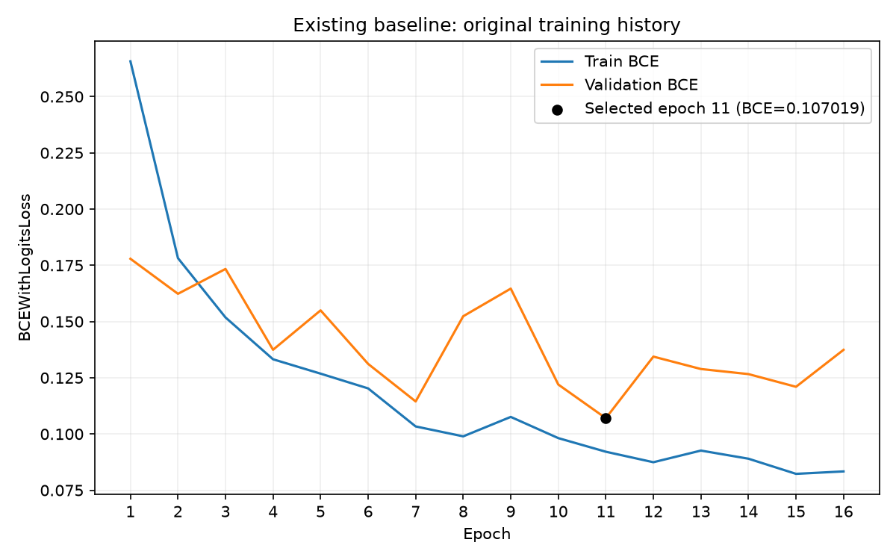
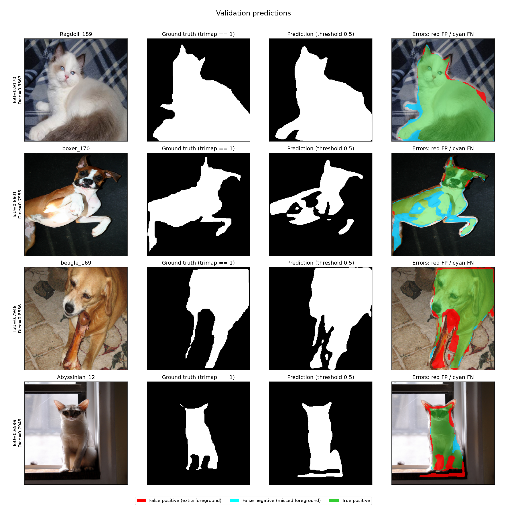
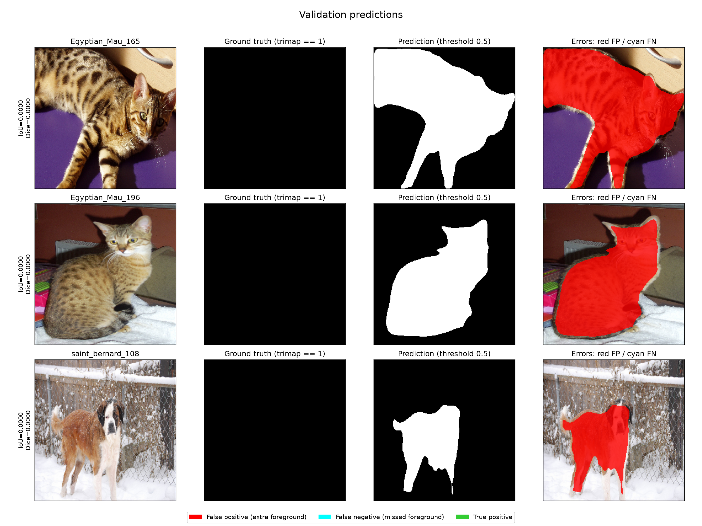
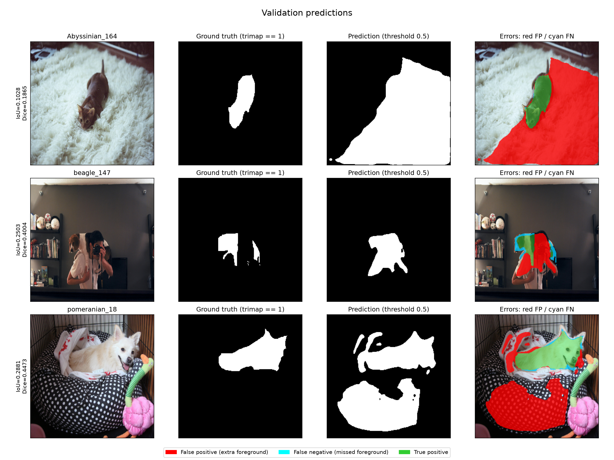

# Stage 2 — First working model

The BCE baseline was evaluated on the 736-image **validation split**. This
report describes its training setup, segmentation metrics and visible errors.

## Data and preprocessing

Oxford-IIIT Pet binary foreground segmentation uses `trimap == 1` as pet;
values 2 and 3 become background. Saved indices define 2944 training, 736
validation and 3669 test images. Train/validation are disjoint and
cover official trainval; official trainval/test image identifiers are disjoint.
All 3680 train/validation masks passed checks for original trimap values,
binary mapping, float32 dtype and transformed shape `(1, 256, 256)`.

Images are resized to 256 × 256 with bilinear interpolation; masks use nearest
neighbor interpolation. Images are divided by 255 and normalized with ImageNet
mean `(0.485, 0.456, 0.406)` and std `(0.229, 0.224, 0.225)`. Training uses
horizontal flips with probability 0.5. Validation has no random augmentation.

## Archived model and training setup

The architecture is a torchvision-based U-Net with an ImageNet-pretrained
ResNet-34 encoder, five decoder blocks with bilinear upsampling and skip connections, and a
one-channel convolutional head producing raw logits. It has 24,521,697 parameters.

| Setting | Verified baseline value |
| --- | --- |
| Loss | `BCEWithLogitsLoss` |
| Optimizer | AdamW, as implemented in `src/train.py` |
| Learning rate / weight decay | 0.0003 / 0.0001 |
| Batch size / seed / workers | 8 / 42 / 0 |
| Frozen encoder epochs | 0 |
| Requested epochs / patience | 20 / 5 |
| Checkpoint selection | Lowest validation BCE |
| Selected epoch / recorded final epoch | 11 / 16 |
| Selected validation BCE from original history | 0.10701909580308458 |

Checkpoint epoch, validation loss and configuration match the original history.
The final epoch is consistent with early stopping after five epochs without
improvement. The original training hardware, runtime and exact package
versions were not recorded.

Training BCE generally decreases, while validation BCE fluctuates. After epoch
11 it does not improve further; the history supports the saved selection.

## Validation results

Evaluation used `.venv`, Python 3.14.7, torch 2.14.1+cu130, torchvision
0.29.1+cu130 and albumentations 2.0.8, on an NVIDIA GeForce RTX 4060 Laptop
GPU with 8 GB VRAM. The full installed environment is in [environment.txt](environment.txt).
Inference used `model.eval()` and `torch.inference_mode()`, float32 without
autocast, and `sigmoid(logits) >= 0.5`. TF32 was disabled for the final results.

| Metric | Validation, 736 images |
| --- | ---: |
| Mean foreground IoU | **0.8529946807133502** |
| Mean foreground Dice | **0.9150923228105341** |
| Pixel accuracy | **0.9577080477838931** |

IoU is TP/(TP+FP+FN), and Dice is 2TP/(2TP+FP+FN), computed independently
per image and then averaged over all 736 images. Pixel accuracy uses total
correct pixels / total pixels, including background. Both masks empty gives
IoU=Dice=1; only one empty gives 0. No metric smoothing is used. These are
validation results, not test estimates.

Machine-readable evidence: [aggregate metrics](val_fp32/metrics.json),
[per-image metrics and identifiers](val_fp32/per_image.csv),
[baseline audit](baseline_audit.json), and [data checks](data_check.json).

The [initial evaluation](val/metrics.json) gave IoU 0.8529982624560063,
Dice 0.9150951329019061 and accuracy 0.9577102661132812. Its batch-size 8/3
comparison had maximum aggregate difference 0.000003694687666477847 and
maximum per-image IoU/Dice difference 0.0010483084910366536. It failed the
predefined per-image tolerance of 0.001 despite very small aggregate changes.
That run did not record backend precision flags, so its exact TF32 settings
cannot be verified retrospectively.

The batch-size 8/3 comparison was repeated with TF32 explicitly disabled.
Image order and SHA-256 of every normalized image and resized mask matched.
All per-image IoU/Dice and aggregate metrics were identical between the two
batch sizes (maximum difference **0**), within tolerances of 1e-5 aggregate
and 1e-3 per-image. Results for batch size 3 are available in
[JSON](val_fp32/batch_size_3/metrics.json) and the accompanying CSV. This result
is consistent with numerical precision as the cause of the first discrepancy; it is not a proof of bitwise agreement
on other GPUs or package versions.

## Visible validation errors

Each figure shows image, ground truth, prediction and error overlay: red is
false positive, cyan is false negative, green is true positive. Identifiers,
scores and selection rules are saved in [example_selection.json](example_selection.json).

The four examples were randomly selected with seed 42. `Ragdoll_189` has
mostly correct foreground with missed edge/paw regions. `boxer_170` has large
false-negative holes in the body. `beagle_169` includes parts of the bone as
foreground. `Abyssinian_12` includes parts of the ledge beneath the cat.

The three lowest-IoU cases are `Egyptian_Mau_165`, `Egyptian_Mau_196`, and
`saint_bernard_108` (IoU=Dice=0). Their **original PNG trimaps contain only
value 2**, despite visibly containing pets. The empty binary targets therefore
come from the source annotations, not resizing. Predictions contain 33,676,
25,047 and 11,223 foreground pixels respectively, all scored as false
positives. These three cases are included in the reported 736-image aggregate.

For supplementary interpretation, the three lowest-IoU cases with nonempty
targets are shown separately; aggregate results still include every image.

| Image | IoU | Dice | FP pixels | FN pixels | Visible discrepancy |
| --- | ---: | ---: | ---: | ---: | --- |
| Abyssinian_164 | 0.102823 | 0.186472 | 30012 | 21 | Large blanket region predicted as foreground |
| beagle_147 | 0.250328 | 0.400420 | 3244 | 757 | Prediction extends beyond the dog into the person; some target regions missed |
| pomeranian_18 | 0.288073 | 0.447293 | 15403 | 463 | Bedding and surrounding objects predicted as foreground |

## Hypotheses and limitations

Possible causes of the visible model errors include fur/background texture
similarity, difficult occlusion, small pets after resizing, and missing fine
details at 256 × 256. These hypotheses have not been tested. The cause of the
three all-background source annotations is unknown. Boundary pixels are
background by task definition, so some errors lie along the pet outline.

Accuracy includes many background pixels and should be read alongside
foreground IoU/Dice. Results cover one checkpoint and one validation split;
there are no repeated-seed uncertainty estimates, final test scores, tuning
results or training/runtime comparisons.

The loss comparison is described in the
[second approach report](../second_approach/results.md). Reproduction commands
are in the repository [README](../../README.md#stage-2-baseline-validation-evidence).
